# TP3 REST : Microservices « Calculatrice » avec Spring Boot

**Faculté des Sciences de Sfax – Département d'informatique et des Communications**
**Matière :** Architecture MicroServices – **Filière :** MPSRCC1 – **Année universitaire :** 2026-2027
**Enseignantes :** Corinne Amel ZAYANI, Amal ABID
**Étudiante :** Amal Karaoud

---

## Organisation du dépôt

```
TP3-MS/
├── README.md
├── calcul-service/        projet Maven (port 8081)
├── historique-service/    projet Maven (port 8082)
└── captures/              captures d'écran citées dans ce compte rendu
```

> Note : toutes les requêtes `curl` ont été exécutées dans **Windows PowerShell** avec `curl.exe`. Pour éviter l'échappement des guillemets, chaque corps JSON est d'abord écrit dans un fichier temporaire (`$d = $env:TEMP`), puis envoyé avec `--data-binary "@$d\fichier.json"`.

---

## Environnement

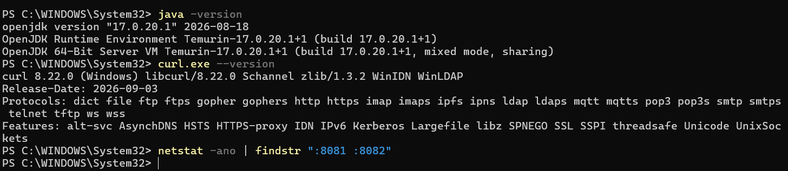

*Figure 0 – Vérification des versions de Java et de curl.*

Les consoles de démarrage indiquent : Spring Boot **4.0.9**, Java **17** (Eclipse Adoptium), Apache **Tomcat 11.0.27** embarqué.

---

## Partie A : Du service web au microservice

### A.4 Questions de conception

**1. Avantage et inconvénient d'un résultat obtenu par requête HTTP.**
*Avantage :* la logique de calcul est isolée dans `calcul-service` ; elle peut être modifiée, redéployée et réutilisée par d'autres services sans toucher à `historique-service`.
*Inconvénient :* l'appel passe par le réseau (latence) et dépend de la disponibilité de l'autre microservice : il peut échouer (service arrêté ou injoignable), ce qui n'arrivait pas avec un simple appel de méthode.

**2. Si `calcul-service` est arrêté.**
*Échouent :* toutes les requêtes `:8081/calcul/...` (service injoignable), ainsi que `POST :8082/operations` et `PUT :8082/operations/{id}`, car elles ont besoin d'un calcul.
*Continuent de fonctionner :* `GET :8082/operations`, `GET :8082/operations/{id}` et `DELETE :8082/operations/{id}`, qui n'utilisent que les données conservées par `historique-service`.

**3. Pourquoi deux microservices ne peuvent pas écouter sur le même port.**
Un port ne peut être ouvert que par un seul processus à la fois : le second démarrage échouerait avec l'erreur `Port ... was already in use`. Chaque microservice a donc son propre port (8081 et 8082).

**4. Code de statut quand `calcul-service` est injoignable.**
**503 (Service Unavailable)** : le serveur ne peut pas répondre pour l'instant parce qu'un service dont il dépend est indisponible.

---

## Partie B : Création du projet `calcul-service`

### B.1 Génération du projet avec Spring Initializr

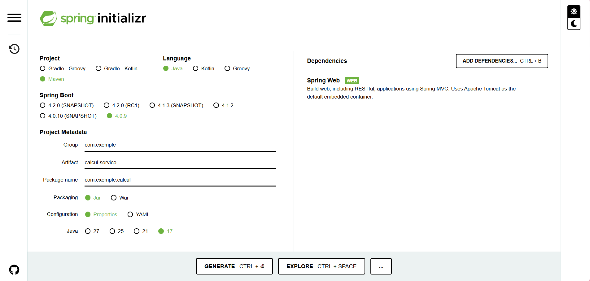

*Figure B1 – Spring Initializr : projet `calcul-service`.*

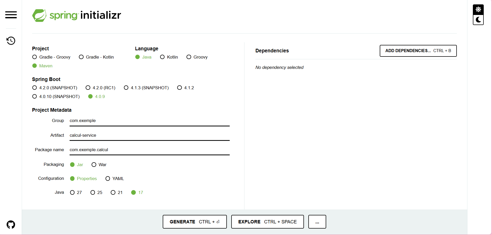

*Figure B1a – Formulaire rempli (Maven, Java, Spring Boot 4.0.9, `com.exemple`, `calcul-service`, `com.exemple.calcul`, Jar, dépendance Spring Web).*

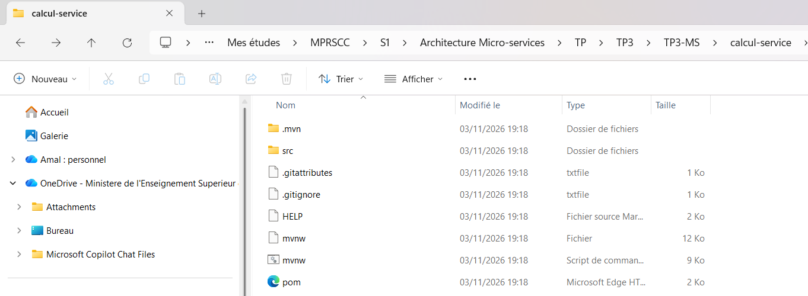

*Figure B1b – Dossier `calcul-service` obtenu après décompression de l'archive.*

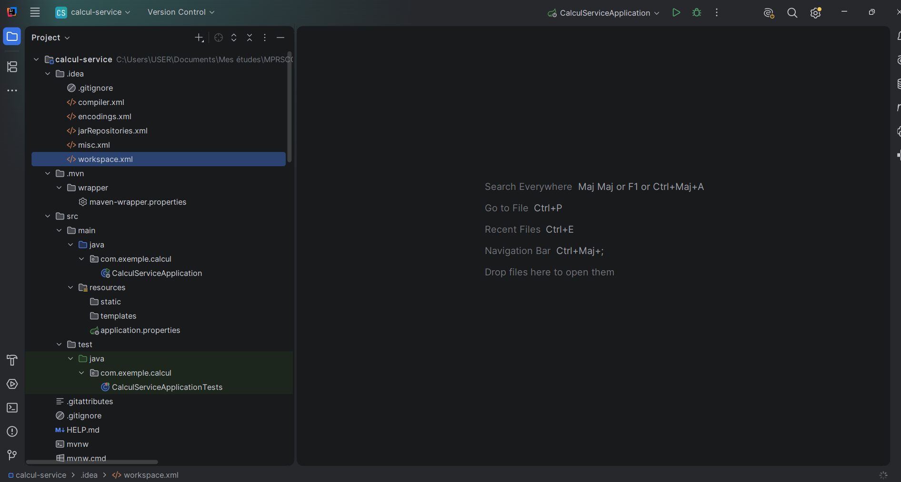

*Figure B1c – Projet ouvert dans IntelliJ IDEA.*

### B.2 Structure du projet

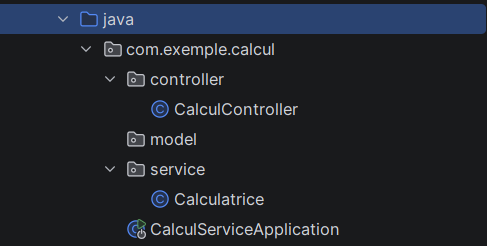

*Figure B2 – Structure de `calcul-service` : paquetages `controller`, `service` et `model` sous `com.exemple.calcul`.*

### B.3 Fichier `pom.xml`

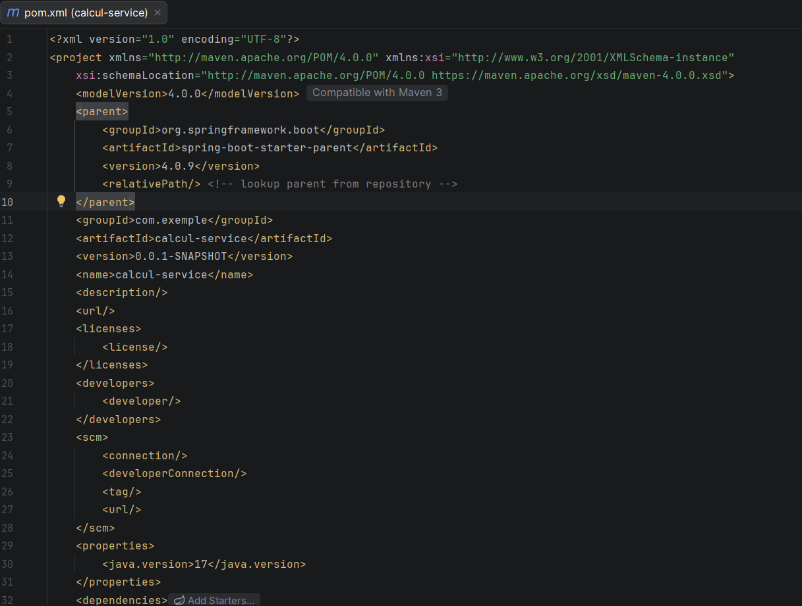

*Figure B3a – `pom.xml` : projet parent `spring-boot-starter-parent` et propriétés.*

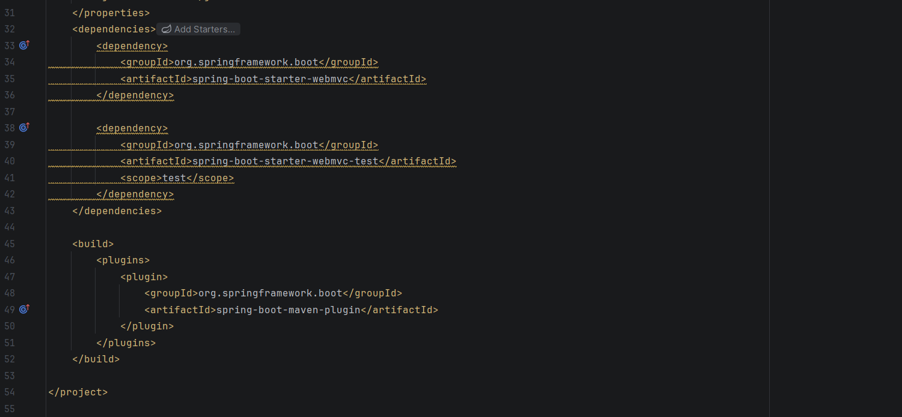

*Figure B3b – `pom.xml` : dépendance `spring-boot-starter-webmvc` et plugin `spring-boot-maven-plugin`.*

### B.4 Classe principale

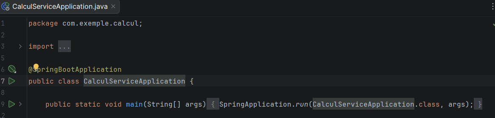

*Figure B4 – Classe `CalculServiceApplication` annotée `@SpringBootApplication`, avec sa méthode `main`.*

---

## Partie C : Premier microservice : la somme

### C.1 Classe `Calculatrice`

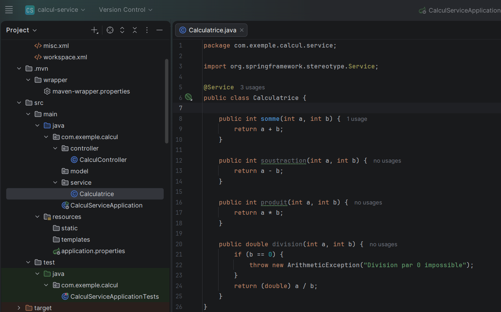

*Figure C1 – Classe `Calculatrice` annotée `@Service` (paquetage `service`).*

### C.2 Classe `CalculController`

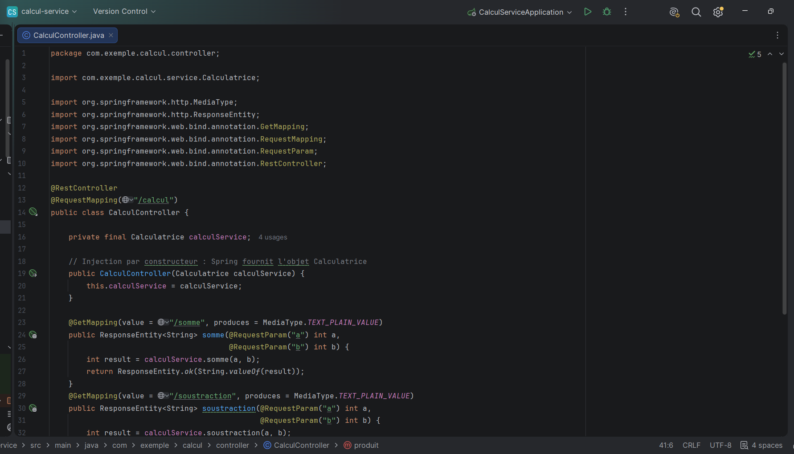

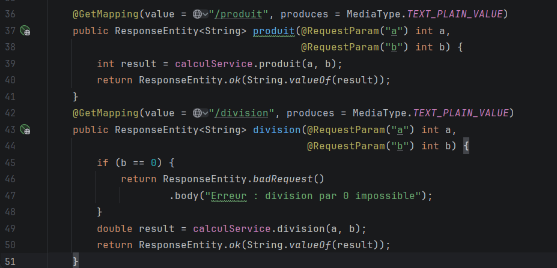

*Figure C2 – Classe `CalculController` avec la méthode `somme`.*

Tableau de correspondance complété :

| Spring (TP3) | JAX-RS (TP2) | Rôle dans cet exemple |
|---|---|---|
| `@RestController` | (pas d'équivalent direct) | Déclare la classe comme contrôleur REST : la valeur retournée par chaque méthode devient le corps de la réponse HTTP. |
| `@RequestMapping("/calcul")` | `@Path("/calcul")` sur la classe | Préfixe commun `/calcul` de toutes les méthodes du contrôleur. |
| `@GetMapping("/somme")` | `@GET` + `@Path("/somme")` | La méthode répond à `GET /calcul/somme`. |
| `produces = MediaType.TEXT_PLAIN_VALUE` | `@Produces(MediaType.TEXT_PLAIN)` | La réponse est renvoyée au format `text/plain`. |
| `@RequestParam("a") int a` | `@QueryParam("a") int a` | Lit le paramètre `a` de la chaîne de requête (`?a=2&b=3`) et le convertit en entier. |
| `ResponseEntity.ok(...)` | `Response.ok(...).build()` | Construit une réponse de statut 200 avec le corps indiqué. |

### C.4 Choix du port : `application.properties`

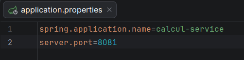

*Figure C4 – `application.properties` : `spring.application.name=calcul-service` et `server.port=8081`.*

### C.5 Lancement du microservice

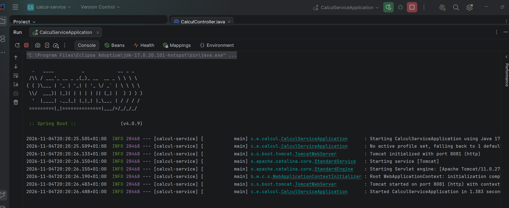

*Figure C5 – Console de `calcul-service` : `Tomcat started on port 8081 (http) with context path '/'`.*

### C.6 Compréhension de l'URL

URL complète : `http://localhost:8081/calcul/somme?a=2&b=3`

| Partie de l'URL | Origine |
|---|---|
| `localhost:8081` | Machine locale et port fixé par `server.port` dans `application.properties` |
| `/calcul` | Annotation `@RequestMapping("/calcul")` de la classe |
| `/somme` | Annotation `@GetMapping("/somme")` de la méthode |
| `?a=2&b=3` | Paramètres de requête lus par `@RequestParam("a")` et `@RequestParam("b")` |

**Question C.1.** Par rapport à l'URL du TP2 (`http://localhost:8080/RestWebApp/api/calcul/somme?a=2&b=3`), ont disparu : `/RestWebApp` (nom du fichier `.war`, qui servait de contexte à l'application dans le Tomcat partagé) et `/api` (préfixe défini par `@ApplicationPath` dans `RestApplication`). Le port change aussi (8080 devient 8081). Avec Spring Boot, chaque microservice embarque son propre Tomcat et s'exécute à la racine (`context path '/'`, visible en figure C5) : il n'y a plus d'application à distinguer des autres, ni de classe `RestApplication`, et les chemins sont directement ceux des annotations `@RequestMapping` et `@GetMapping`.

### C.7 Tests du service

**Navigateur**

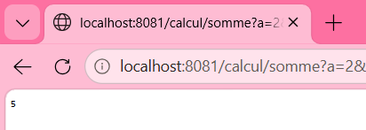

*Figure C7a – `http://localhost:8081/calcul/somme?a=2&b=3` affiche 5.*

**curl**

```powershell
curl.exe -i "http://localhost:8081/calcul/somme?a=2&b=3"
```

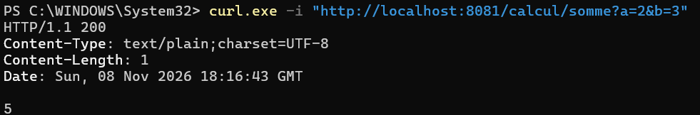

*Figure C7b – Réponse `HTTP/1.1 200`, `Content-Type: text/plain;charset=UTF-8`, corps `5`.*

**Postman**

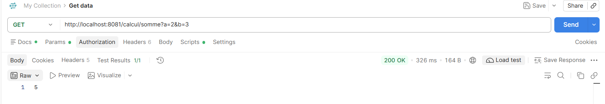

*Figure C7c – `GET` : corps `5`, statut 200 OK.*

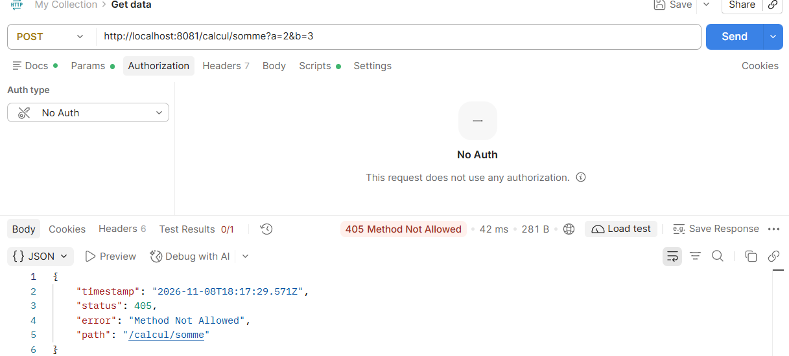

*Figure C7d – `POST` sur la même URL : statut 405.*

**Question C.2.** En remplaçant `GET` par `POST`, on obtient le statut **405 (Method Not Allowed)** : l'URI existe, mais seule la méthode `GET` est associée à `/calcul/somme`. C'est le même code qu'au TP2.

---

## Partie D : Compléter la calculatrice

### D.1 Soustraction et produit

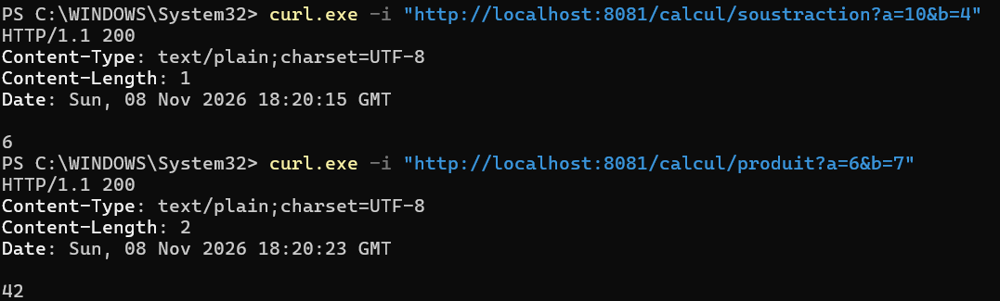

*Figure D1 – `GET /calcul/soustraction?a=10&b=4` (6) et `GET /calcul/produit?a=6&b=7` (42).*

### D.2 Division et gestion d'erreur

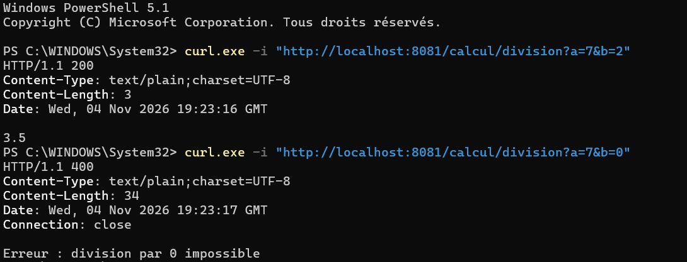

*Figure D2 – `GET /calcul/division?a=7&b=2` (200, 3.5) et `GET /calcul/division?a=7&b=0` (400, `Erreur : division par 0 impossible`).*

### D.3 Observations

| N° | Requête | Statut | Corps |
|---|---|---|---|
| 1 | `GET /calcul/somme?a=2` (paramètre `b` absent) | 400 | Objet JSON d'erreur Spring |
| 2 | `GET /calcul/somme?a=abc&b=3` (`a` non entier) | 400 | Objet JSON d'erreur Spring |

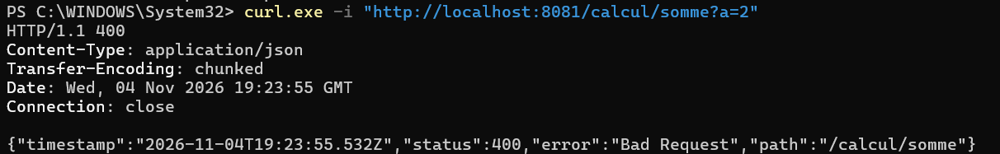

*Figure D3 – Paramètre `b` absent.*

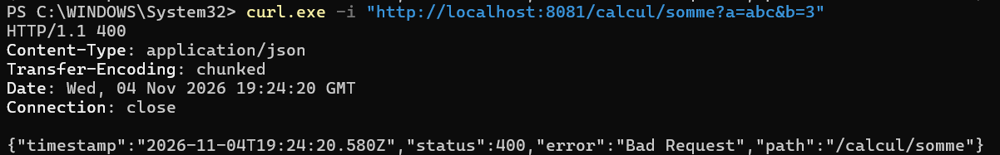

*Figure D4 – Paramètre `a` non entier.*

**Question D.1.** Dans les deux cas, Spring n'exécute pas la méthode et répond **400 (Bad Request)**, alors que JAX-RS donnait la valeur 0 au paramètre absent et calculait quand même. L'attitude de Spring est la plus conforme à REST : une requête incorrecte est signalée au client par un statut 4xx, au lieu d'être exécutée avec une valeur par défaut qui renvoie un résultat faux sans avertissement.

**Question D.2.** L'objet JSON d'erreur contient les champs `timestamp`, `status`, `error` et `path`.

### D.4 Paramètres dans le chemin : `@PathVariable`

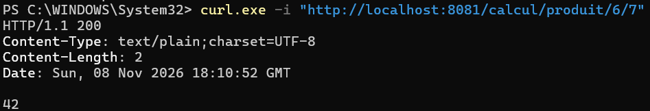

*Figure D5 – `GET /calcul/produit/6/7` retourne 42.*

**Question D.3.** `@RequestParam` correspond à `@QueryParam` et `@PathVariable` correspond à `@PathParam`. Pour lire l'identifiant dans `/operations/{id}`, on utilise `@PathVariable`.

---

## Partie E : Échanger des données en JSON

### E.1 Classe `Resultat`

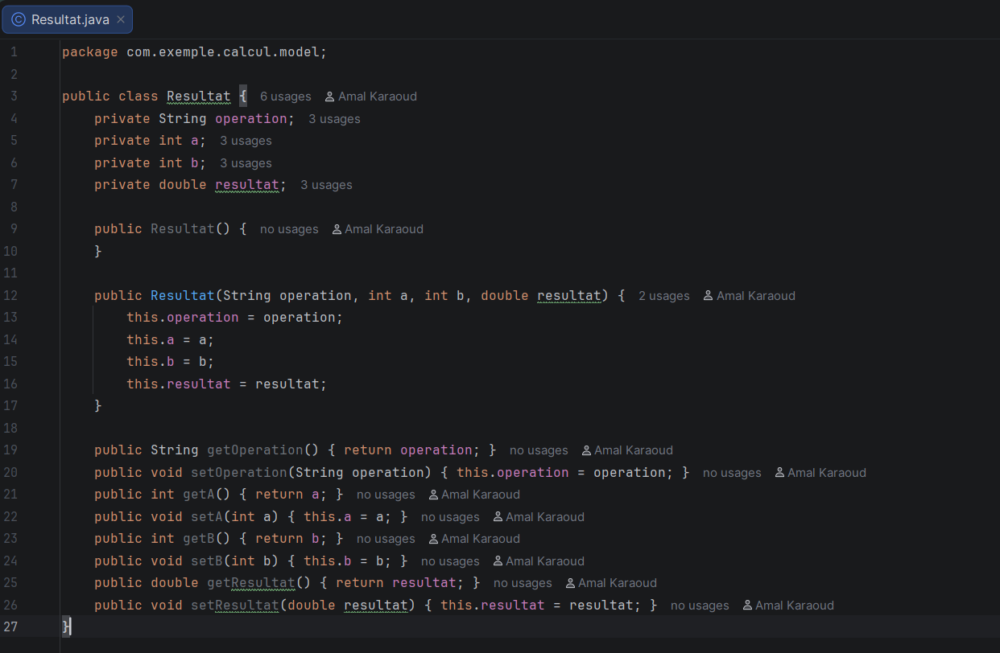

*Figure E1 – Classe `Resultat` (constructeur sans argument, constructeur complet, accesseurs).*

### E.2 Méthode qui produit du JSON

```powershell
curl.exe -i "http://localhost:8081/calcul/somme/detail?a=2&b=3"
```

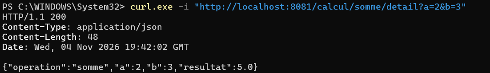

*Figure E2 – Statut 200, `Content-Type: application/json`, corps JSON de l'objet `Resultat`.*

**Question E.1.** Les deux textes JSON sont équivalents pour un client : dans un objet JSON, l'ordre des champs n'a pas de signification, seuls comptent les noms et les valeurs. Cette fois, la conversion a été effectuée par **Jackson**, inclus dans `spring-boot-starter-webmvc`, à la place de JSON-B.

### E.3 L'en-tête `Accept`

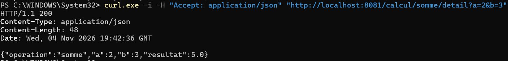

*Figure E3a – `Accept: application/json` : statut 200.*

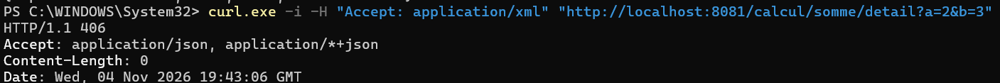

*Figure E3b – `Accept: application/xml` : statut 406.*

**Question E.2.** La méthode produit un objet converti en JSON par Jackson, et aucun convertisseur capable de produire du XML n'est disponible dans le projet. Spring ne peut donc pas satisfaire `Accept: application/xml` et répond **406 (Not Acceptable)**, même si le code ne mentionne aucun format.

### E.4 Exercice : `divisionDetail`

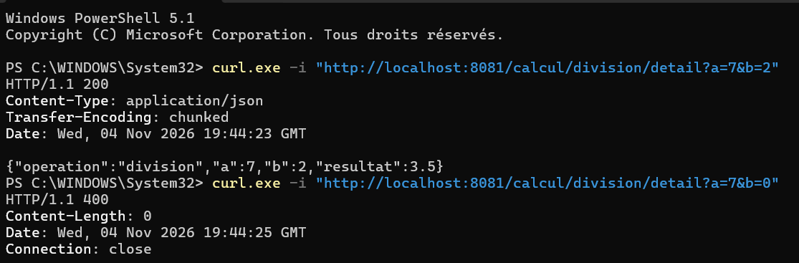

*Figure E4 – `GET /calcul/division/detail` : 200 avec l'objet `Resultat` pour `b` non nul, 400 pour `b = 0`.*

### Code final de `CalculController`

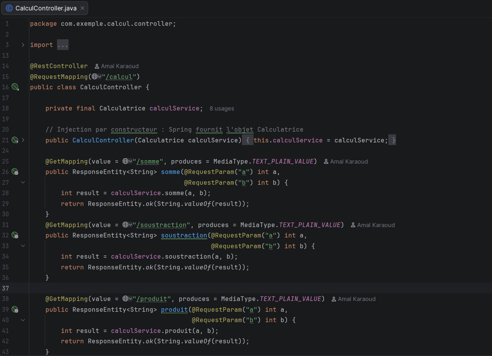

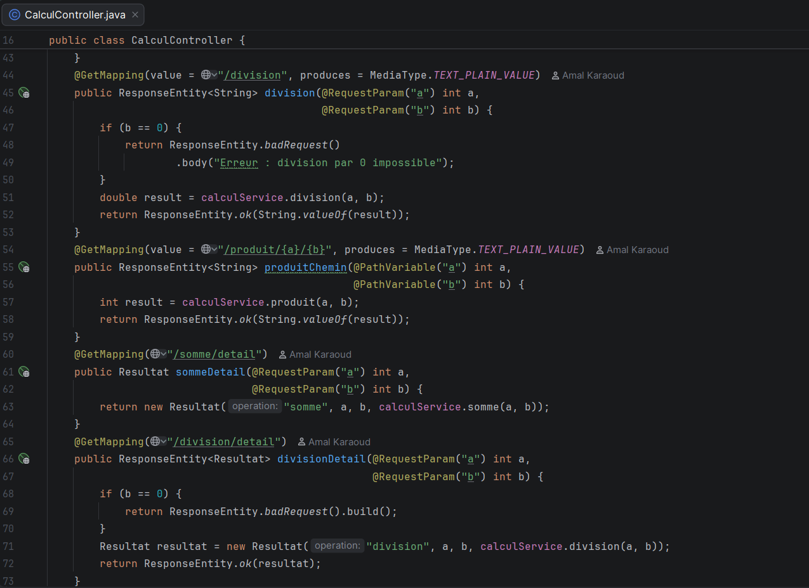

*Figure E5 – Classe `CalculController` complète.*

---

## Partie F : Second microservice : `historique-service`

### F.1 Création du projet

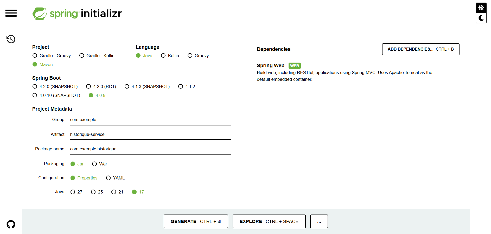

*Figure F1 – Spring Initializr : Maven, Java 17, Spring Boot 4.0.9, `com.exemple`, `historique-service`, `com.exemple.historique`, Jar, dépendance Spring Web.*

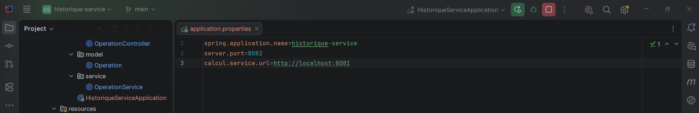

*Figure F1b – `application.properties` : port 8082 et propriété `calcul.service.url=http://localhost:8081`.*

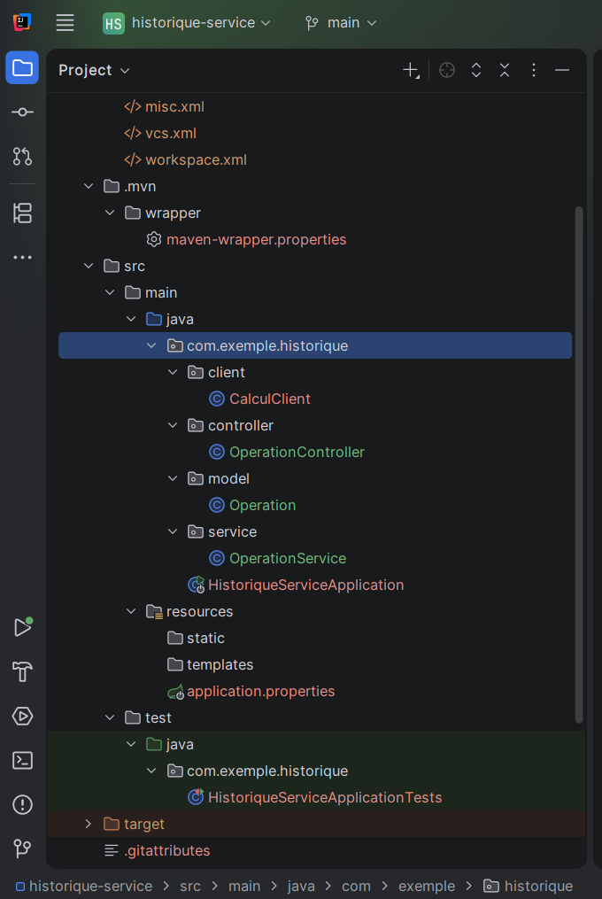

*Figure F1c – Structure de `historique-service` : paquetages `client`, `controller`, `model` et `service`.*

### F.2 Classe `Operation`

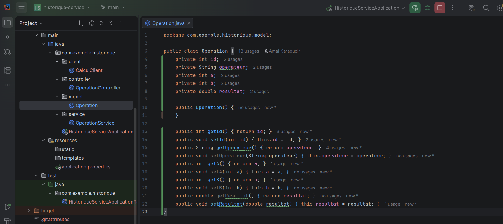

*Figure F2 – Classe `Operation`.*

### F.3 Classe `CalculClient`

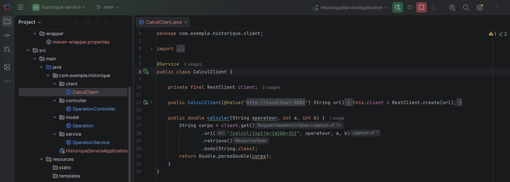

*Figure F3 – Classe `CalculClient` (appel HTTP vers `calcul-service` avec `RestClient`).*

### F.4 Classe `OperationService`

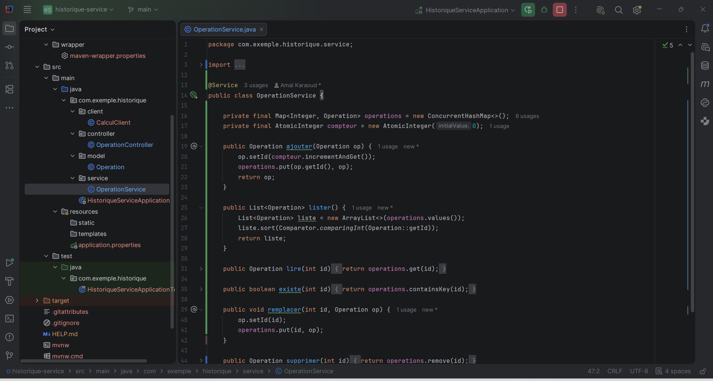

*Figure F4 – Classe `OperationService` (stockage en mémoire).*

### F.5 Classe `OperationController`

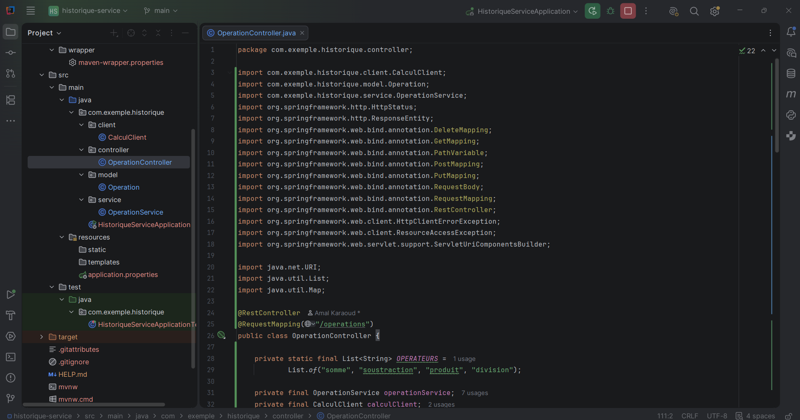

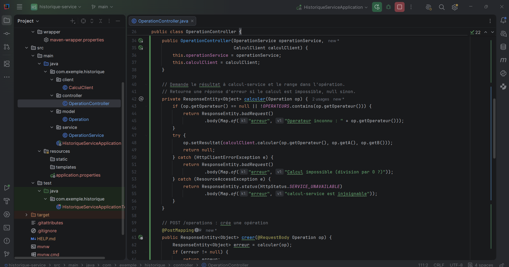

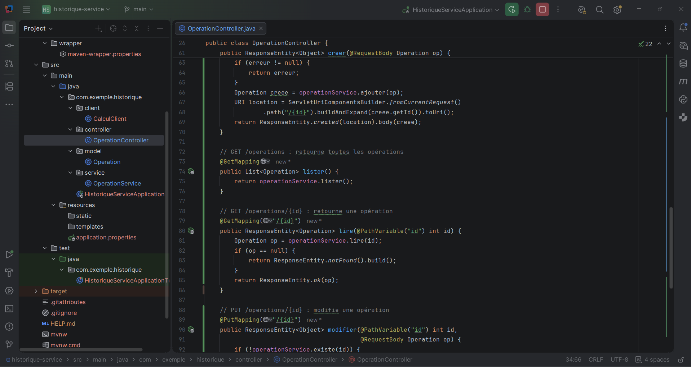

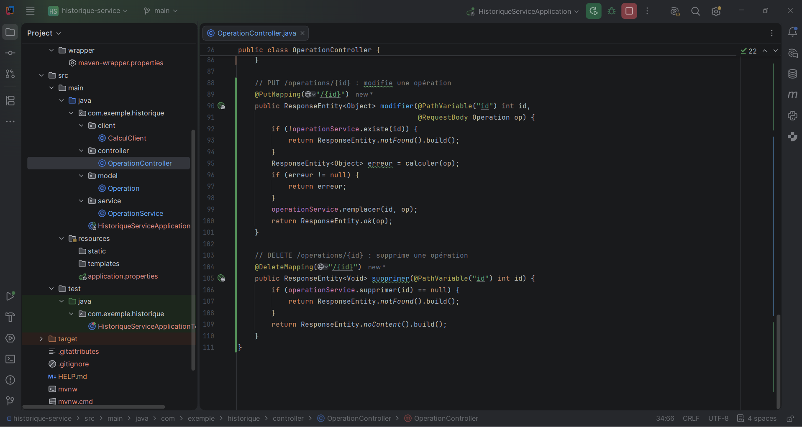

*Figure F5 – Classe `OperationController` complète (quatre captures successives).*

### F.6 Tests de création et de lecture

#### Les deux microservices en marche

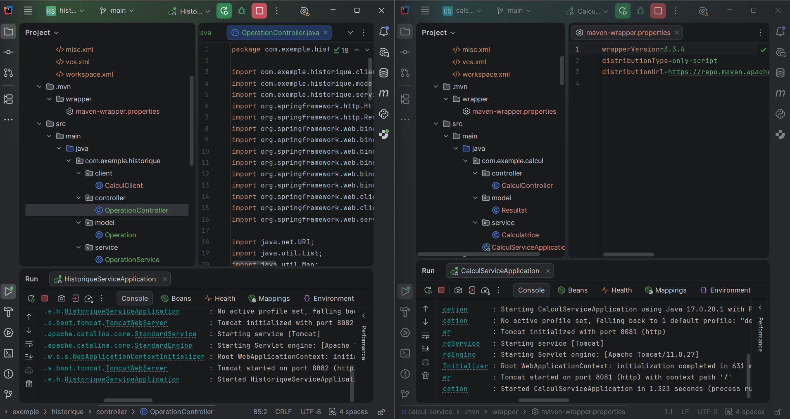

*Figure F6 – À gauche `historique-service` (`Tomcat started on port 8082`), à droite `calcul-service` (`Tomcat started on port 8081`).*

#### Trace dans la console de `calcul-service`

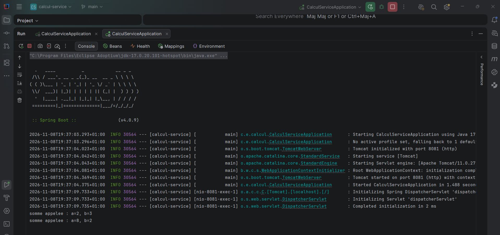

*Figure F6b – La trace `somme appelee : a=8, b=2` s'affiche dans la console de `calcul-service` lors du `POST` de `historique-service` : la requête passe bien par `calcul-service`.*

#### Série de tests

| N° | Requête | Corps envoyé | Statut obtenu | Réponse obtenue |
|---|---|---|---|---|
| 1 | `POST /operations` | `{"operateur":"somme","a":8,"b":2}` | 201 | `Location: http://localhost:8082/operations/1` – `{"a":8,"b":2,"id":1,"operateur":"somme","resultat":10.0}` |
| 2 | `POST /operations` | `{"operateur":"division","a":7,"b":2}` | 201 | `Location: http://localhost:8082/operations/2` – `{"a":7,"b":2,"id":2,"operateur":"division","resultat":3.5}` |
| 3 | `GET /operations` | Aucun | 200 | Liste des deux opérations (id 1 et id 2) |
| 4 | `GET /operations/2` | Aucun | 200 | `{"a":7,"b":2,"id":2,"operateur":"division","resultat":3.5}` |
| 5 | `GET /operations/99` | Aucun | 404 | Aucun corps (`Content-Length: 0`) |
| 6 | `POST /operations` | `{"operateur":"division","a":7,"b":0}` | ⚠️ À COMPLÉTER | ⚠️ À COMPLÉTER |
| 7 | `POST /operations` | `{"operateur":"racine","a":9,"b":0}` | 400 | `{"erreur":"Operateur inconnu : racine"}` |

**Test 1**

```powershell
curl.exe -i -X POST -H "Content-Type: application/json" --data-binary "@$d\t1.json" "http://localhost:8082/operations"
```

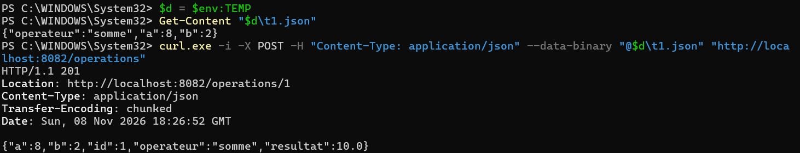

**Test 2**

```powershell
curl.exe -i -X POST -H "Content-Type: application/json" --data-binary "@$d\t2.json" "http://localhost:8082/operations"
```

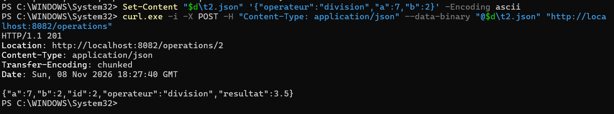

**Test 3**

```powershell
curl.exe -i "http://localhost:8082/operations"
```

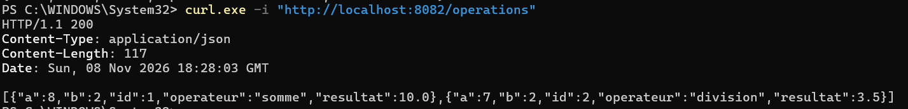

**Test 4**

```powershell
curl.exe -i "http://localhost:8082/operations/2"
```

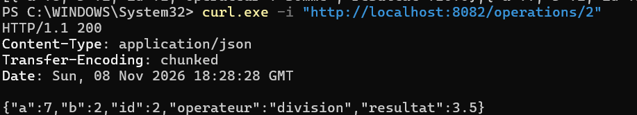

**Test 5**

```powershell
curl.exe -i "http://localhost:8082/operations/99"
```

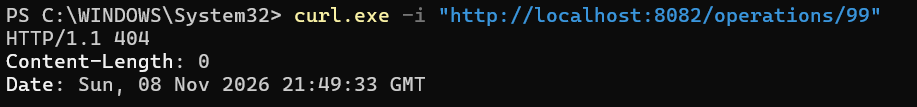

**Test 6**

```powershell
curl.exe -i -X POST -H "Content-Type: application/json" --data-binary "@$d\t6.json" "http://localhost:8082/operations"
```

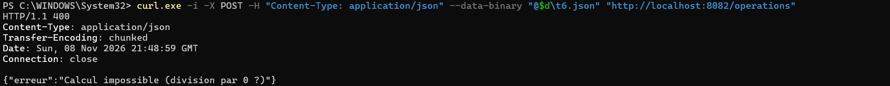

**Test 7**

```powershell
curl.exe -i -X POST -H "Content-Type: application/json" --data-binary "@$d\t7.json" "http://localhost:8082/operations"
```

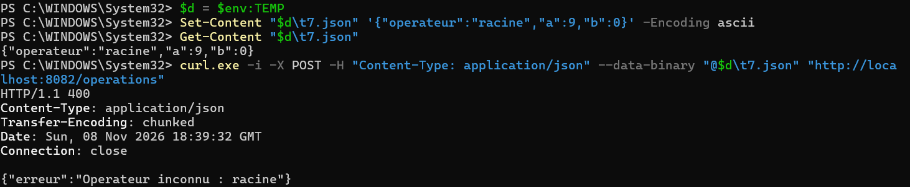

### F.7 Expérience : arrêter un microservice

`calcul-service` est arrêté, `historique-service` reste en marche.

| N° | Requête | Corps envoyé | Statut obtenu | Réponse obtenue |
|---|---|---|---|---|
| 8 | `GET /operations` | Aucun | 200 | `[{"a":8,"b":2,"id":1,"operateur":"somme","resultat":10.0}]` |
| 9 | `GET /operations/1` | Aucun | 200 | `{"a":8,"b":2,"id":1,"operateur":"somme","resultat":10.0}` |
| 10 | `POST /operations` | `{"operateur":"produit","a":3,"b":4}` | 503 | `{"erreur":"calcul-service est injoignable"}` |

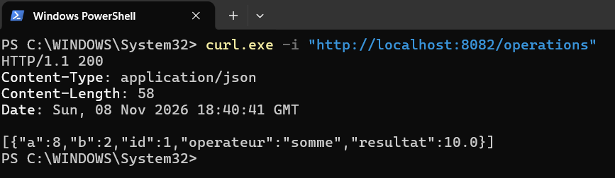

*Figure F7a – Test 8.*


*Figure F7b – Test 9.*


*Figure F7c – Test 10 pendant l'arrêt de `calcul-service` : 503.*

**Test 10 après relance de `calcul-service`**


*Figure F7d – Statut 201, `{"a":3,"b":4,"id":1,"operateur":"produit","resultat":12.0}`.*

> Remarque : l'identifiant obtenu est 1 et non 3, car `historique-service` a été redémarré entre-temps (expérience de la question F.2, qui impose de modifier le code puis de relancer le service). Les opérations étant conservées en mémoire, elles sont perdues à chaque arrêt et la numérotation repart de 1.

**Question F.1.** Les lectures continuent de fonctionner parce que `GET /operations` et `GET /operations/{id}` ne lisent que les opérations déjà enregistrées en mémoire par `historique-service` : elles n'appellent pas `calcul-service`. Au TP2, cette situation n'était pas possible : le calcul et l'historique appartenaient à la même application `RestWebApp.war`, et le calcul était un simple appel de méthode. L'application fonctionnait en entier ou ne fonctionnait pas du tout.

**Question F.2.** Sans le bloc `catch (ResourceAccessException e)`, l'exception lancée par `RestClient` n'est traitée nulle part : Spring répond **500 (Internal Server Error)** avec son objet JSON d'erreur par défaut (`timestamp`, `status`, `error`, `path`), sans message utile pour le client. C'est ce que montre la figure ci-dessous. Un 500 signale un bug du serveur, alors que la vraie cause est l'indisponibilité d'un service dont on dépend : le statut 503 est donc plus précis.


*Figure F7e – `POST /operations` sans le bloc `catch` : statut 500.*


*Figure F7f – Code du contrôleur avec le bloc `catch (ResourceAccessException e)` mis en commentaire.*

### F.8 Modifier une opération : `PUT`

| Situation | Statut | Corps de la réponse |
|---|---|---|
| Aucune opération ne porte cet identifiant | 404 | ⚠️ À COMPLÉTER |
| Le calcul est impossible (opérateur inconnu, division par 0) | 400 | ⚠️ À COMPLÉTER |
| `calcul-service` est injoignable | 503 | ⚠️ À COMPLÉTER |
| Modification réussie | 200 | ⚠️ À COMPLÉTER |

**Test principal : `PUT /operations/1` avec `{"operateur":"produit","a":8,"b":2}`**

```powershell
curl.exe -i -X PUT -H "Content-Type: application/json" --data-binary "@$d\t8.json" "http://localhost:8082/operations/1"
curl.exe -i "http://localhost:8082/operations/1"
```


*Figure F8a – Statut obtenu : ⚠️ À COMPLÉTER (attendu : 200 avec un résultat de 16.0).*


*Figure F8b – Vérification par `GET /operations/1`.*

**Autres situations**


*Figure F8c – `PUT /operations/99` : identifiant inexistant.*


*Figure F8d – `PUT /operations/1` avec l'opérateur `racine` : calcul impossible.*


*Figure F8e – `PUT /operations/1` avec `calcul-service` arrêté.*

### F.9 Supprimer une opération : `DELETE`

| Situation | Statut | Corps de la réponse |
|---|---|---|
| Aucune opération ne porte cet identifiant | 404 | ⚠️ À COMPLÉTER |
| Suppression réussie | 204 | Aucun corps |

```powershell
curl.exe -i -X DELETE "http://localhost:8082/operations/1"
curl.exe -i "http://localhost:8082/operations/1"
curl.exe -i -X DELETE "http://localhost:8082/operations/1"
```


*Figure F9a – Premier `DELETE` : statut obtenu ⚠️ À COMPLÉTER (attendu : 204).*


*Figure F9b – `GET /operations/1` après suppression : statut obtenu ⚠️ À COMPLÉTER (attendu : 404).*


*Figure F9c – Second `DELETE` : statut obtenu ⚠️ À COMPLÉTER (attendu : 404).*

---

## Questions de synthèse

### 1. Tableau A.3 : étape où chaque différence a été observée

| Aspect | Étape d'observation |
|---|---|
| Technologie (Spring Boot / Spring MVC) | B.3 : `spring-boot-starter-webmvc` dans le `pom.xml` |
| Découpage | A.2, puis B.1 et F.1 : deux projets distincts |
| Résultat de la construction (`.jar`) | B.3 : absence de `<packaging>war</packaging>`, `spring-boot-maven-plugin` ; C.5 |
| Serveur (Tomcat embarqué) | C.5 : console `Tomcat started on port 8081` ; F.6 : deux consoles |
| Port | C.4 : `server.port=8081` ; F.1 : `server.port=8082` |
| Adresse | C.6 et C.7 : `http://localhost:8081/calcul/somme` |
| Activation | B.4 : `@SpringBootApplication` et méthode `main` |
| Ressource REST | C.2 : `@RestController` et `@RequestMapping` |
| Verbes HTTP | C.2 (`@GetMapping`), F.5 (`@PostMapping`), F.8 (`@PutMapping`), F.9 (`@DeleteMapping`) |
| Paramètres | C.2 (`@RequestParam`), D.4 (`@PathVariable`), F.5 (`@RequestBody`) |
| Réponse HTTP | C.2 et D.2 : `ResponseEntity` |
| Conversion JSON | E.2 : Jackson |
| Création des objets | C.1 et C.2 (`@Service`, injection par constructeur) ; F.4 (singleton, sans `static`) |
| Communication | F.3 et F.6 : requête HTTP de `historique-service` vers `calcul-service` (trace de la figure F6b) |

### 2. Correspondance entre les annotations JAX-RS (TP2) et Spring (TP3)

| JAX-RS (TP2) | Spring (TP3) |
|---|---|
| Classe `RestApplication` + `@ApplicationPath` | `@SpringBootApplication` + méthode `main` |
| `@Path` sur la classe | `@RestController` + `@RequestMapping` |
| `@Path` sur la méthode | Chemin indiqué dans `@GetMapping("/...")`, `@PostMapping`, etc. |
| `@GET` | `@GetMapping` |
| `@POST` | `@PostMapping` |
| `@PUT` | `@PutMapping` |
| `@DELETE` | `@DeleteMapping` |
| `@QueryParam` | `@RequestParam` |
| `@PathParam` | `@PathVariable` |
| `@Consumes` + paramètre du corps | `@RequestBody` |
| `@Produces` | `produces = ...` |
| `Response` | `ResponseEntity` |
| `Response.created(uri)` / `uriInfo.getAbsolutePathBuilder()` | `ResponseEntity.created(location)` / `ServletUriComponentsBuilder.fromCurrentRequest()` |
| JSON-B | Jackson |
| `new Calculatrice()` et attributs `static` | `@Service` et injection par constructeur |

### 3. Construire et lancer les deux microservices sans IntelliJ

Dans un premier terminal :

```powershell
cd calcul-service
mvn clean package
java -jar target/calcul-service-0.0.1-SNAPSHOT.jar
```

Dans un second terminal :

```powershell
cd historique-service
mvn clean package
java -jar target/historique-service-0.0.1-SNAPSHOT.jar
```

`mvn clean package` produit un `.jar` exécutable qui contient l'application, ses dépendances et le Tomcat embarqué ; `java -jar` le lance directement. Sans construire le `.jar`, on peut aussi utiliser `mvn spring-boot:run` à la racine de chaque projet. Chaque microservice reste actif tant que son terminal est ouvert (arrêt par `Ctrl+C`).

### 4. Microservice et service web

Un microservice **est** un service web : `calcul-service` et `historique-service` répondent à des requêtes HTTP (URI, verbes, JSON), comme le service du TP2. En revanche, un service web **n'est pas toujours** un microservice : `RestWebApp.war` du TP2 était un service web, mais une application unique regroupant le calcul et l'historique, déployée dans un Tomcat installé à part. Un microservice est de plus autonome : il a son propre serveur embarqué et son propre port, il est responsable d'une seule fonctionnalité, et il peut être démarré, arrêté et redéployé indépendamment des autres (expérience F.7).

### 5. Adresse de `calcul-service` écrite dans `application.properties`

Avec trois exemplaires de `calcul-service` (trois ports différents), `historique-service` ne connaît qu'une seule adresse : tout le trafic va vers un seul exemplaire, les deux autres ne servent à rien et la charge n'est pas répartie. Si l'exemplaire désigné tombe, `historique-service` ne bascule pas vers un autre. Il faudrait modifier la configuration à chaque changement d'exemplaires. Ce problème sera traité au TP4 (découverte de services et répartition de charge avec Spring Cloud).

### 6. Principe stateless et liste des opérations

Le principe *stateless* interdit au serveur de mémoriser l'état de la conversation avec un client (par exemple une session) : chaque requête doit contenir tout ce dont le serveur a besoin pour la traiter. La liste des opérations n'est pas l'état d'un client mais **la donnée de la ressource `/operations`**, partagée par tous les clients. Chaque requête reste autonome : `GET /operations/1` renvoie le même résultat quel que soit le client, sans dépendre des requêtes précédentes de celui-ci.

### 7. Répétition de `POST` et de `PUT`

- Deux fois le même `POST /operations` : deux opérations distinctes sont créées (deux identifiants différents). Le `POST` n'est **pas idempotent**.
- Deux fois le même `PUT /operations/1` : l'opération 1 est remplacée deux fois par le même contenu, l'état final est identique à celui obtenu après un seul envoi. Le `PUT` est **idempotent**.

La réponse n'est pas différente de celle du TP2 : l'idempotence est une propriété des verbes HTTP, indépendante de la technologie (JAX-RS ou Spring).
